# MOPE-1

A sad wavetable synth for the M-VAVE FM-1, with an old-toy-keyboard backing band that only plays
depressing beats. It plays anyway.

The main character is a blob: a lit, glossy jelly in chunky pixels, floating in a small sad room with
a rainy window behind it. It shows what the sound is doing, and everything you turn happens to it. Under it, the
part you are working on opens as a schematic: the envelope, the LFO, the filter curve, drawn the
classic way, live.

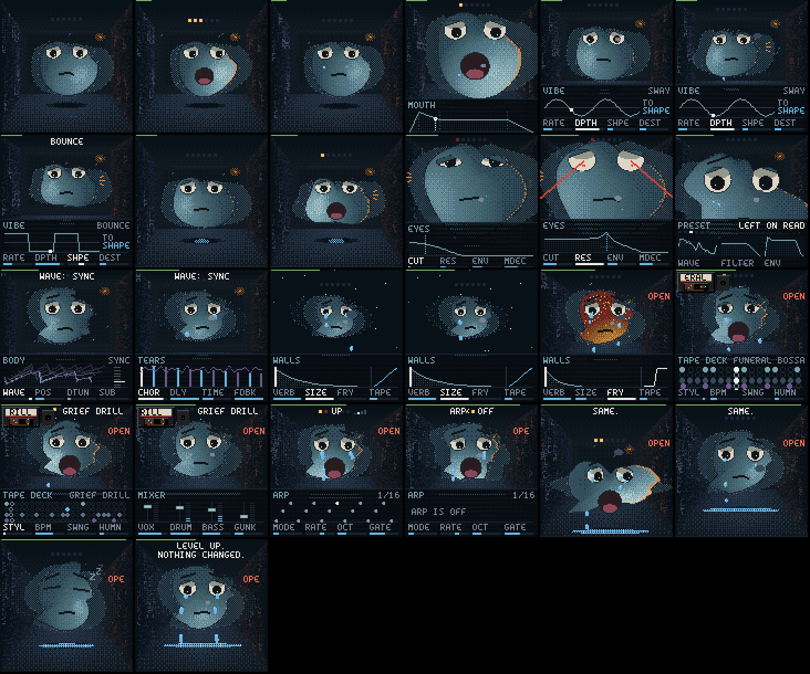

The instrument, the blob, its room and tears, the maths underneath and the browser player are
MOPE-1's own. It runs on the open FM-1 platform of [Felucca](https://github.com/hugelton/Felucca) (the
drivers, the update loader, safe mode, the installer's protocol and the build tools), which reached it
through X0X, FoMni and FiMba-1, the firmware MOPE-1 started from.

> **Status: beta, tested on a real FM-1.** It installs from M-VAVE's own firmware, plays, records and
> updates itself on the device. Install it from **https://slothpallas.github.io/mope-1/** (Chrome or Edge, USB)
> or play it there in the browser. Custom firmware is installed at your own risk: keep M-VAVE's stock
> firmware (m-vave.com/download) to go back.

## The blob is the synth

| You turn | What happens to the blob |
| --- | --- |
| **Table, Position** | Its outline is the wavetable wrapped round it, and it wobbles with the live output. Morphing the position reshapes its body. |
| **Detune** | A ghost of itself drifts apart from it, beating. |
| **Sub** | It gets heavier, and its bottom spreads. |
| **Cutoff** | Its big eyes: wide open, then half-lidded, then shut (stoned), all the way. |
| **Resonance** | Its pupils shrink to pinpoints and start to glow, and at the top they become laser eyes. |
| **Filter kind, Drive** | The Eyes page's curve shows the kind: low-pass, band-pass (a squint), high-pass (wide awake), notch (a wink) or comb (the blinds). |
| **Sigh: Env amount / Mod decay** | Its eyebrows rise with every note. |
| **Attack / Decay / Sustain / Release** | Its big mouth opens wide with the note, stays open at the sustain and closes with the release. A long release is a yawn. |
| **LFO** | Its whole body dances at the rate, as far as the depth: a sway (side to side, leaning into it), a bob (stretching as it rises), a bounce (squashed when it lands), a nod, a twitch, a heave (filling up slowly, then letting it all out), a wander (off somewhere and back), a stagger (sideways in four lurches) or a throb (two swells and a rest, like a heart); its lumps wobble along. It dances big while notes sound (riding their envelope), shows you a preview while you turn the Vibe knobs, and only murmurs when idle. |
| **Chorus** | See-through copies of itself peek out from behind it, a beat out of step: one a side, then more, further out and fainter. |
| **Delay** | It cries one tear per echo. Each tear is smaller than the one before, and they fall as far apart as the echoes. They collect in a dark puddle on the floor in front of it, which mirrors it (blurred, upside down) and ripples when a tear lands. |
| **Reverb, Size** | The walls throw cold light back onto its edges as the reverb rings. A bigger room pushes the walls out and the blob gets smaller in it. Past the walls is the void, with stars. |
| **Fry** | It gets deep-fried in burnt patches: brown, crusty, sweating, then steaming. |
| **Volume** | Its dirty orange aura. |
| **Clipping** | It catches fire and looks calm (this is fine). |
| **The drums** | A smoky see-through cassette in the top-left corner, the tape winding between its spools, the style on its label, its reels turning at the tempo. Kicks squash the blob and make the light flinch, snares make it blink, hats are rain on the window. Gabber makes it shake. |
| **Nothing** | Its mouth rests at meh. It falls asleep; much later it wakes up and stares at you. |

| | | | |
| --- | --- | --- | --- |
| 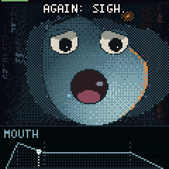 envelope | 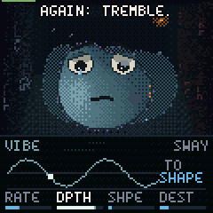 LFO | 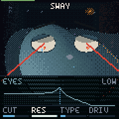 resonance | 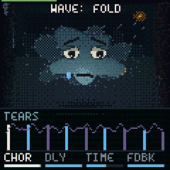 delay + chorus |
| 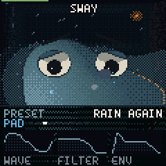 a preset's card | 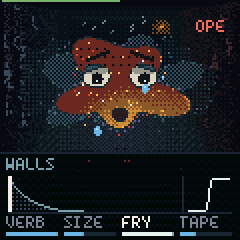 fry | 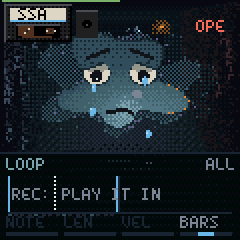 drums | 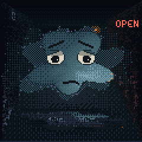 the blob alone |
| 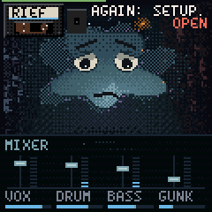 mixer | 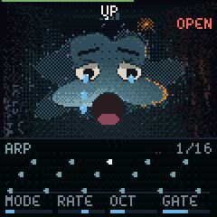 arpeggiator | 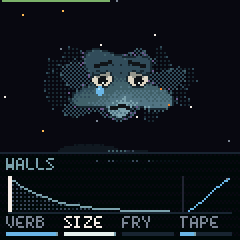 the void | 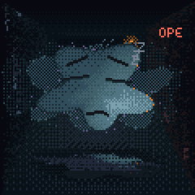 asleep |

## The look

- **Pixels, lit wrong:** 120 x 120 pixels shown at 2x. The blob and its copies are shaded per pixel through a 4 x 4 dither, by a light that comes from below like a torch under a chin. Each note swings that light round the blob by its pitch, the envelope brightens it, and a kick makes it flinch. There is a soft dull sheen (none in close-ups), a one-pixel dark edge, and the streetlamp's orange rim that grows with the volume. The reverb shows as cold light thrown back by the walls onto its edges. It reflects in the wet floor.
- **Never a ball:** it sags at the bottom like a slime, has lumps that slowly drift, and leans a little; the wavetable shapes the rest.
- **The room is tones, not lines:** a back wall lit in the middle and fading at its edges (no frame), a window that fades into it, the window's light falling on the floor. The side walls are lit differently: cold plaster on the left, the lamp's faint warmth on the right, and tiny broken pieces of the font drip down both, barely there, like rain made of text.
- **Colour:** sad blues for the world. Warm reds, oranges and amber only for what is happening: the lamp's rim, the kick's edge, resonance, fry, the playheads, the meter you are turning.
- **Its own font:** a droopy 4 x 6 face. Crossbars sag, tops are rounded, the S slides, the T leans and the V is lopsided.

## Controls

Press or hold a part's button: its schematic opens in a dark glass drawer over the bottom of the screen and the four knobs turn that part, each knob's name over its meter (the one you turn lights up). The drawer stays until 3 seconds after your last touch, then slides away, but **the page stays**: its button stays lit and the knobs still turn that part (turning one brings the drawer back). **HOME** goes back to the Body. **Some parts have a second page:** press the button again while its page shows (HOME: Shadow, ENV: Sigh, LFO: Tremble, GLO: Setup, SEQ: Tape deck). Until you've found one, the caption nudges you (AGAIN: SHADOW.). **Press a part's button twice quickly and its drawer stays open** (switch pages with the other buttons) until you press **HOME**. OCT+ or OCT− is lit while the keyboard is shifted up or down. The blob stays big and shows faintly through the glass. The drawer is drawn in the room's cold colours, like the drum grid.

| Page | Its schematic |
| --- | --- |
| Body | the wavetable's frames stacked, the one playing in front, the detuned copy sliding, the position on a frame ladder |
| Eyes | the filter's curve for its kind (low, band, high, notch, or the comb's teeth) and its resonance peak, the cutoff marked, and where the note's envelope opens it now (red) |
| Mouth | the ADSR, a red dot riding it where the loudest note is |
| Vibe | the LFO's wave (more cycles: faster), a red dot at its phase, where it goes |
| Tears | the delay's taps, ping (blue) and pong (coral), each smaller; the chorus as a wobbling ribbon |
| Walls | the reverb's tail (its length: Size), tape's wobble on it, the fry's transfer curve |
| Tape deck | the drum grid as round steps in the room's cold colours (kick pale blue, snare tear-blue, hats rain-grey, bass violet; soft hits dimmer, empty steps rings), the fill on the fourth bar, a pale glint for the playhead |
| Mixer | four channel strips: each a fader and a live meter (voice, drums, bass, gunk) |
| Arp | the next 16 steps as a piano roll, the playing one lit, each as long as the gate |
| Setup | a note gliding to the next, MIDI out and channel |
| Shadow | the second wave over the first at its interval, how they meet (mix, FM, ring, sync), the interval in semitones |
| Sigh | the second envelope's rise and fall, a red dot where the loudest note is; meters for how far it moves the wave (W, up or down the table) and the eyes (E) |
| Tremble | the second LFO, drawn like Vibe's |

| Button | Part | KNOB 1 | KNOB 2 | KNOB 3 | KNOB 4 |
| --- | --- | --- | --- | --- | --- |
| HOME | Body | Table | Position | Detune | Sub |
| HOME again | Shadow | Its table | Tune (semitones, ±24) | Meets (mix, FM, ring, sync) | Level (0: off) |
| EDIT | Eyes | Cutoff | Resonance | Kind (low, band, high, notch, comb) | Drive |
| ENV | Mouth | Attack | Decay | Sustain | Release |
| ENV again | Sigh | Its attack (0: the mouth's) | Its decay | Wave (how far it sweeps the table, either way) | Eyes (how far it opens the filter) |
| LFO | Vibe | Rate | Depth | Shape (sway, bob, bounce, nod, twitch, heave, wander, stagger, throb) | Destination (shape, eyes, voice, volume, shadow) |
| LFO again | Tremble | Rate | Depth | Shape | Destination |
| FX | Tears | Chorus | Delay | Time | Feedback |
| SEL | Walls | Reverb | Size | Fry | Tape |
| SEQ | Loop | Note | Length | Velocity (of the chosen step, or the whole loop) | Bars (1, 2, 4) |
| SEQ again | Tape deck | Style | Tempo | Swing | Human (looser timing and velocity) |
| GLO | Mixer | Voice | Drums | Bass (0: no bass) | Gunk |
| GLO again | Setup | Glide | MIDI channel | MIDI out | Tune |
| ARP | Arp | Mode (up, down, up and down, wander, stab) | Rate (1/4 .. 1/32, triplets) | Octaves (1-3) | Gate |

- **ALGORITHM** changes only the instrument's sound source, its wavetable (the blob's body shape). The caption says which ("WAVE: SIGH"); everything else stays.
- **PRESETS** loads a whole saved sound at once: wave, filter, envelope, LFO and effects. Its card opens in the drawer: the name, where it sits in its kind, and thumbnails of the wave, filter and envelope it brought.
- **SELECT**: the drum tape (the blob swaps the cassette and shrugs).
- **Close-ups:** while you hold EDIT (Eyes) the view moves in on its eyes; while you hold ENV (Mouth), on its mouth.
- **PLAY**: the band on and off: drums, bass and your loop. **ARP**: tap for the arpeggiator on or off; hold for its page: the keys you hold become its pattern, at the tempo, starting each bar with the drums.

### Recording a loop

As on X0X, Melodee and JIANT FM: **PLAY**, **REC** and **SEQ** do what they say.

- **REC while stopped**: a one-bar count-in (four red lights, a click on each beat), then the band starts and what you play is recorded into the loop (1, 2 or 4 bars; the Loop page's Bars). Notes snap to the 1/16 grid; the tape deck's Human puts some looseness back. The arpeggiator's notes are recorded too.
- **REC while playing**: it records at once, on top of what's there (overdub). **REC** again stops recording; the loop keeps playing with the band.
- **HOME + REC** undoes the last take. **SAVE + REC** clears the loop.
- **SEQ** (press it twice to keep it open): the loop as a piano roll, and while it is open the **16 white keys are the steps** of one bar (not while recording: then they play). Press a step to **choose** it and hear it; an empty step gets the last note you played. Turn **NOTE, LEN, VEL** to edit the chosen step. **Tap** a step without turning a knob to remove its notes. With no step chosen (the drawer says ALL) the knobs edit the **whole loop**: transpose it, make it longer or shorter, louder or softer. **OCT− / OCT+** go to the other bars.
- The loop is saved with your sound (up to 192 notes).
- REC used to be "hold"; that's gone.
- **OCT− / OCT+**: octave. The 27 keys play F3 to G5.
- **SAVE**: saves (it also saves by itself when quiet). Hold for 1.5 s, then press SAVE again, to reset everything. The blob keeps its level.
- The lowest and highest keys together: it gives up.

**Presets** (38, in six kinds; the card shows the kind):
- **Pad:** Monday, 3AM, Rain again, Church of nothing, Sunday scaries, Seen 2:14, Weighted blanket, The void stares, Slow heart
- **Keys:** Left on read, Hold music, Open plan, Music box, Glass office, Elevator
- **Pluck:** NPC, Read receipt, Bubble wrap, Typing..., Icicle
- **Lead:** Main character, Low battery, Deep fried, Cry on the floor, Bent out of shape, Drama
- **Bass** (an octave down): Sub-par, Bottom text, Doomscroll, Basement, Hollow inside, Underslept
- **FX:** Tinnitus, Dial tone, Ghosted, Heavy breathing, Broken record, Phantom vibrate

**Drum styles:** each named after its genre, sadly: Grief drill, Empty city pop, Gloom gabber, Missed phonk call, Jersey cry club, Heartbreakcore, Amapia-no, Cold footwork, Dembow out, Vaporweep, Hyperflop, Funeral bossa, Office ambivalent. Each style has a main bar, a fill every fourth bar, its own tempo and swing, and a synthesized kit (no samples). In Amapia-no the bass is a log drum.

**Gunk** is the room's texture: rain on the window, a record's crackle, a low rumble. It swells when nothing plays and steps back when something does, and the rain on the window follows it.

**The bass is always sad:** the auto-bass plays natural minor. Hold something that sounds major (or one note) and it plays the relative minor, a minor third down: hold C and it plays A minor, every note of which is also in C major. Hold a minor chord and it plays that minor. Any note in a pattern outside the minor scale is pulled onto it.

**MIDI in:** notes with velocity, and pitch bend. The mod wheel moves the position and program change
picks a mood. CCs: 74 cutoff, 71 resonance, 73 attack, 72 release, 70 position, 91 reverb, 93 chorus,
94 delay, 7 volume.

**Levels:** every note is XP. Levels change nothing, but the captions say so ("LEVEL UP. NOTHING
CHANGED."). Level 10 gives it a balloon, mostly deflated.

## The sound

- **16 wavetables:** Sigh, Moan, Pulse, Crush, Warble, Fold, Church, Sync, Glass, Breath, Cry, Hollow,
  Bend, Toy, Ice, Sag. Each has 8 frames, built at
  boot from harmonic recipes, so they take no flash space. Each frame is mipmapped at five sizes, so
  high notes don't alias (the test checks C7 on Sync: aliases at −68 dB).
- **6 voices:** two detuned oscillators panned apart, a sine sub, slow analog drift, a resonant
  filter (Simper's SVF: low, band, high or notch; or a comb) with key tracking and drive, an amp ADSR
  and a mod envelope (its own attack) on the cutoff and the wavetable's position. A stolen voice
  restarts from its current level, so stealing doesn't click.
- **The shadow:** a second oscillator per voice, its own table, ±24 semitones away, mixed in, frequency
  modulating the first, ring modulating it or synced to it.
- **Two LFOs** with 9 shapes (sine, triangle, square, saw down, random, saw up, smooth random, four steps,
  a heartbeat) and 5 destinations (the position, the cutoff, the pitch, the volume, the shadow).
- **It keeps up:** on the FM-1 a heavy sound (the shadow, drive, a band-pass) plays fewer voices so
  the audio never runs late, and if a moment still runs hot it lets the oldest voice go quickly.
- **Presets at one level:** each preset carries a trim measured on the FM-1, so switching doesn't jump.
- **Effects:** fry (drive, then bitcrush and sample-rate crush), a three-tap chorus, the tears (a
  ping-pong delay: every echo crosses the room darker and thinner, its time wobbling with Tape), the
  room (a reverb of eight walls handing sound to each other, four of them breathing; Size goes from a
  one-second closet to a half-minute void), tape (wow, flutter, saturation, a darker top) and a limiter.
- **Fry is level-matched:** more fry is more grit, not more loud (full fry stays within about 2 dB of clean), and it glides, so a preset change doesn't slam it in.
- **Drums:** synthesized kick (808 to gabber), snare, clap, closed and open hats, perc (rim, cowbell,
  log drum, squeak), a sliding 808 bass and record crackle. They run sample-accurate with swing.

The test suite renders every table and every drum style to WAV in `build/host/synth/`.

## Try it

```bash
tests/run_tests.sh
```

It runs the engine tests and writes the demo WAVs, then the app scenario (screenshots land in
`build/scenarios/blob/`), then the browser build if Emscripten is installed. To play it in a browser:

```bash
web/play/build.sh && node tools/serve_play.mjs
```

Then open <http://localhost:8137>, or open `build/play/MOPE-1.html` straight from disk. Computer keys:
`Q`–`I` and `A`–`K` play the white keys and `1`–`0`, `-` the black ones. `Space` is PLAY, `Enter` REC,
`B` ARP, `Esc` HOME, `Z` `X` the octave. `↑` `↓` turn ALGORITHM (the wavetable) and `←` `→` SELECT (the drum tape).
To put the player in another page, serve `index.html`, `voice.js` and `mope.wasm` from `build/play/`
together and frame `index.html`: in a frame it drops its title and installer, and it needs no `data:`
scripts, only `'wasm-unsafe-eval'` if the page has a content security policy.

## Installing it

1. Download M-VAVE's stock firmware (FM-1 V15 or V16, "PC Firmware", m-vave.com/download) so you can always go back.
2. Plug the FM-1 into the computer directly with a USB data cable, open **https://slothpallas.github.io/mope-1/** in Chrome or Edge, and press **Install MOPE-1**. Or from a terminal: `python3 tools/fm1_install.py mope-0.1.0.fwsc`.
3. It takes about a minute; don't unplug while it writes (if it's cut off, press Install again: it continues).

Leaving it is the same: install another firmware, or M-VAVE's, from the hub or its own installer. If a firmware ever crashes at start-up, the FM-1 comes up in safe mode after two tries (USB on, the installer works); the chip's own update mode can't be overwritten.

**Saves and other firmwares:** MOPE-1 keeps its sound and loop in the same flash slot FiMba-1 and FoMni use for their projects (0xFC000), and the panel calibration at 0xDC000, as they do. It can't read another firmware's project there (it starts from its defaults) and saving overwrites it; the same goes the other way.

The package identity is `FM-1_6673` ("MOPE" on a phone keypad) followed by the version, e.g. `FM-1_6673000100` for 0.1.0. No other firmware on thefirmwarehub.com uses it. The device build runs on GitHub (the JieLi toolchain is Linux-only); [BUILDING.md](BUILDING.md) has the details.

## Licence

GPL-3.0-only, like the platform it runs on: see [LICENSING.md](LICENSING.md) for what is MOPE-1's and
what comes from where. Not affiliated with M-VAVE.
